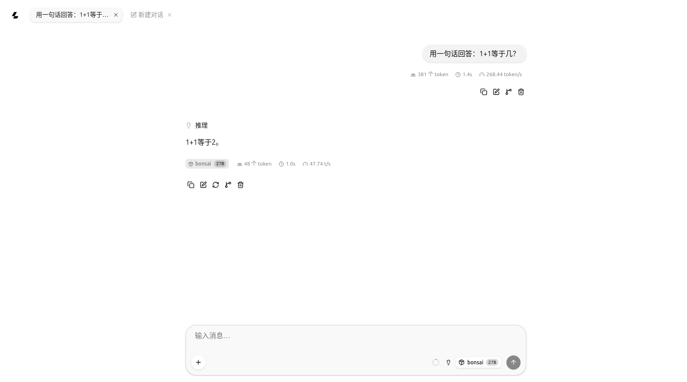
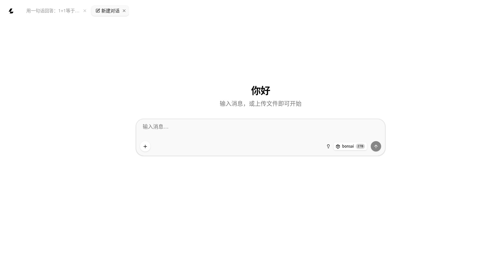
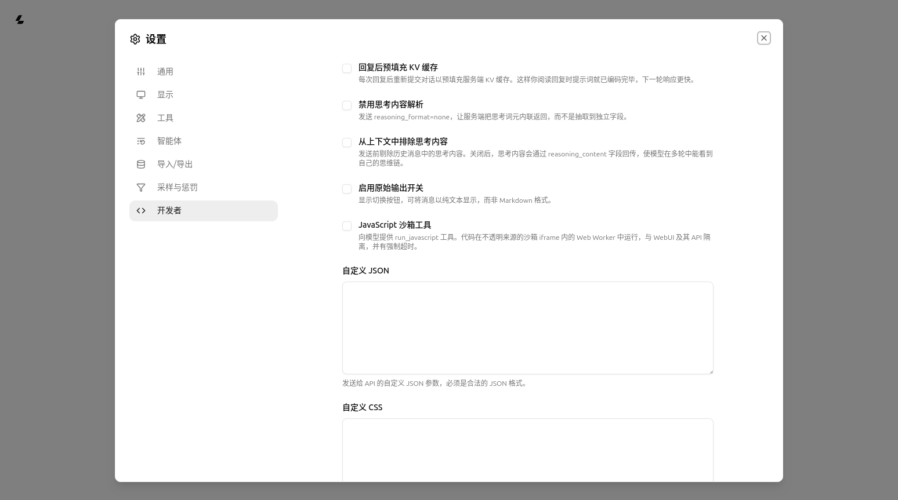

# llama.cpp WebUI 简体中文语言包（新版 UI）

把 llama.cpp 的**新版 WebUI**（SvelteKit 界面，`tools/ui`，2026 年版，如 `b12232`）汉化成简体中文，顺带支持 [PrismML-eng/llama.cpp](https://github.com/PrismML-eng/llama.cpp) fork（例如 `prism-b12232-f702476`）。

**不重新编译前端、不改一行功能代码**：只对官方静态 UI 的 `bundle.*.js` 做上下文精确的字面量替换，生成 `webui-zh/` 目录，启动 `llama-server` 时加 `--path` 挂载即可；想回退英文删掉目录、去掉参数就行。



| 首页 | 设置 |
| --- | --- |
|  |  |

## 为什么需要它

- 截至 2026-11，llama.cpp 官方 WebUI **没有 i18n**：issue [#30822](https://github.com/ggml-org/llama.cpp/issues/30822) 仍是 feature request，曾经实现 39 种语言的 PR [#19059](https://github.com/ggml-org/llama.cpp/pull/19059) 被关闭，且只覆盖旧版 UI。
- 本项目在社区补丁 [Yao-Shun-Ya/llama-webui-zh](https://github.com/Yao-Shun-Ya/llama-webui-zh)（针对 `b11344` 的 496 条词表）基础上，补了 **新版 UI 新增的约 150 条文案**，并处理了动态拼接文案、`aria-label/title/placeholder`、页面标题、单复数等。

## 特性

- 覆盖：侧边栏、对话页、消息操作、统计信息、推理块、输入框、工具调用提示
- 设置对话框全部 7 个页签：通用 / 显示 / 工具 / 智能体 / 导入导出 / 采样与惩罚 / 开发者
- 模型页、模型选择器、能力徽标、排序提示、页面标题、无障碍标签
- 自动注销旧 Service Worker、清缓存，避免"改了没生效"的经典问题；附带一键修复页 `reset.html`
- 全部文案集中在 `scripts/extra_zh.json`，想改哪句直接改，改完重跑脚本即可

## 快速开始

前提：你已经能跑起 `llama-server`（官方 llama.cpp 或 PrismML fork 均可），并且 WebUI 能打开（默认 `http://127.0.0.1:8080`）。

```bash
git clone https://github.com/Entropysilence231/llama-webui-zh-cn.git
cd llama-webui-zh-cn
./install.sh          # 会从本机 127.0.0.1:8080 镜像原版 UI，再生成 webui-zh/

# 重启 llama-server，加上 --path
llama-server -m /path/to/model.gguf -ngl 99 -fa on -c 32768 -np 1 \
  --host 127.0.0.1 --port 8080 \
  --path "$(pwd)/webui-zh"
```

刷新浏览器（首次建议 `Ctrl+Shift+R`），界面即中文。

如果服务不是跑在 `127.0.0.1:8080`：`BASE_URL=http://127.0.0.1:8081 ./install.sh`。

## 手动步骤（等价于 install.sh）

```bash
# 1) 从运行中的 llama-server 镜像英文原版 UI 到 webui-en/
BASE_URL=http://127.0.0.1:8080 python3 scripts/mirror_en.py

# 2) 生成 webui-zh/（脚本会自动识别当前 bundle 哈希）
python3 scripts/apply_zh.py

# 3) 挂载
llama-server ... --path "$PWD/webui-zh"
```

## 目录结构

```
.
├── install.sh                 # 一键：镜像 + 生成
├── scripts/
│   ├── mirror_en.py           # 从运行中的 llama-server 抓取原版静态资源
│   ├── apply_zh.py            # 生成简中 webui-zh/
│   ├── extra_zh.json          # 新增文案词表（可自由修改）
│   ├── reset.html             # 浏览器缓存/Service Worker 一键修复页
│   └── upstream_patch_b11344.py  # 上游词表（MIT，见文件头署名）
├── screenshots/
├── THIRD_PARTY/               # 第三方许可证原文
└── webui-en/ webui-zh/        # 运行 install.sh 后生成（已 gitignore）
```

## 升级 / 维护

llama.cpp 每次发版，前端 bundle 的文件名哈希会变，但本项目的流程是自适应的：

```bash
# 1) 更新你的 llama.cpp（官方或 PrismML fork）
# 2) 先临时去掉 --path 启动 llama-server（镜像源必须是英文界面）
# 3) 重新镜像 + 重新生成：
./install.sh
# 4) 重启 llama-server，恢复 --path（不变）
```

> 注意：`mirror_en.py` 是"从运行中的服务器抓取原版静态资源"，所以镜像时服务器必须是在英文界面（即没有挂 `--path webui-zh`）。如果已经挂着中文包，脚本会直接报错并提示你先去掉 `--path`。

如果新版本出现个别没翻译的英文，把它加进 `scripts/extra_zh.json`（键=英文原文，值=中文），再跑一次 `python3 scripts/apply_zh.py` 即可。

## 浏览器缓存 / 还是英文怎么办

这个 WebUI 带 PWA，旧版英文界面注册的 Service Worker 会缓存旧的 `index.html` 和 `bundle`，导致"服务端已汉化、浏览器还是英文"。本项目生成的页面已经内置自注销 SW 的脚本，**清理一次就不会再犯**。三种清理方式：

1. 打开 `http://127.0.0.1:8080/reset.html`（本项目附带的一键修复页）；
2. 无痕窗口打开试试；
3. 浏览器清除本站 Cookie 与缓存（Firefox：地址栏锁图标 → 清除 Cookie 和站点数据；或 `F12 → 存储 → Service Workers → 注销`），然后 `Ctrl+Shift+R`。

## 已知限制

- 只负责"翻译"，依赖官方 UI 的静态资源结构；上游 UI 大改（组件/路由重构）时需要更新词表。
- 模型名、`MCP`、`JSON`、`token`、采样参数名（`top_k` 等）、API 字段名保留英文——这些是通用技术术语，翻译反而不便使用。
- 不修改功能代码，所以若某个文案是服务端下发或第三方组件内置的（如 KaTeX、Mermaid 内部提示），不在汉化范围内。
- 已在 `prism-b12232-f702476`（PrismML fork，新版 UI，浅色/深色主题）+ Firefox / Chrome 上验证；其他版本理论可用，词表命中率可能略有差异（脚本会打印未命中数量，属正常）。

## 致谢与许可

本项目是翻译补丁，不包含上游代码产物、模型或 UI 打包文件。署名如下：

- **[Yao-Shun-Ya/llama-webui-zh](https://github.com/Yao-Shun-Ya/llama-webui-zh)**（MIT，Copyright (c) 2026 Yao-Shun-Ya）：`scripts/upstream_patch_b11344.py` 中的翻译词表与"bundle 字面量替换 + `--path` 挂载"的思路来自该项目，本仓库在其基础上适配了新版 UI 并增补词表。许可证原文见 `THIRD_PARTY/llama-webui-zh-LICENSE`。
- **[ggml-org/llama.cpp](https://github.com/ggml-org/llama.cpp)**（MIT，Copyright (c) 2023-2026 The ggml authors）：被汉化的 WebUI 与其构建产物；本仓库只对运行时的静态资源做文本替换，未修改、未再分发其产物。
- **[PrismML-eng/llama.cpp](https://github.com/PrismML-eng/llama.cpp)**：本次适配验证所用 fork（Ternary Bonsai 2.5 27B 的运行时）。
- 词表增补与适配：[@Entropysilence231](https://github.com/Entropysilence231)。

本仓库其余部分以 [MIT](LICENSE) 许可发布。与上述项目及公司无隶属关系。
